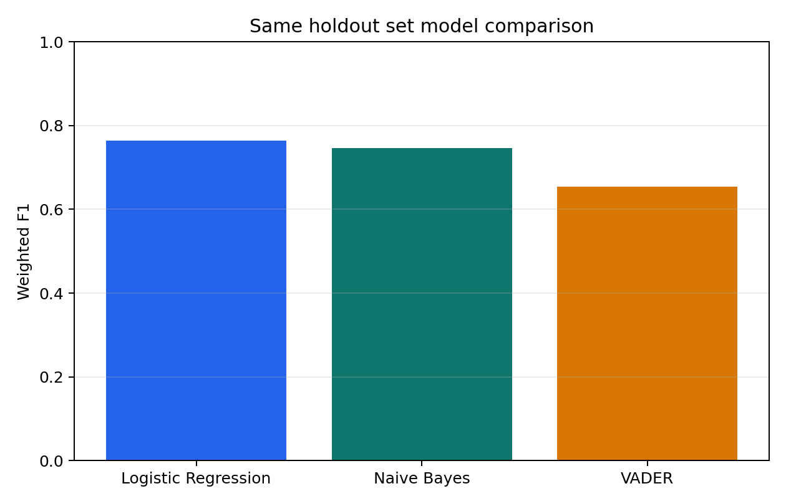
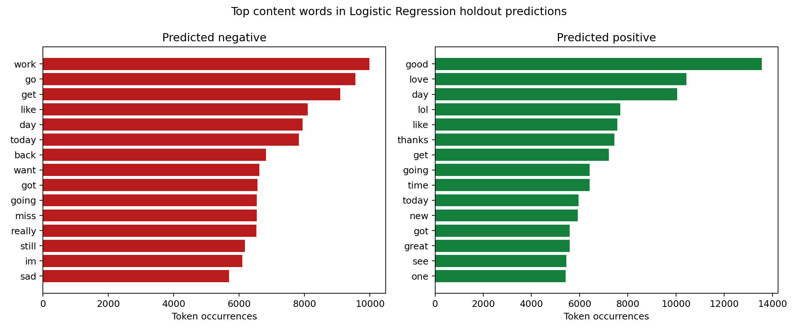
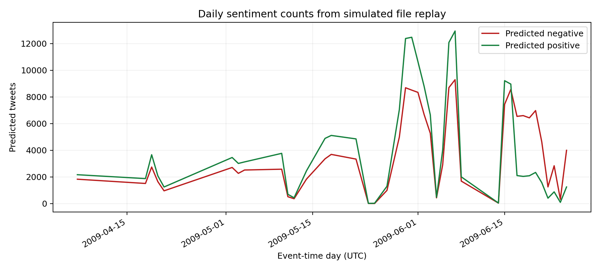
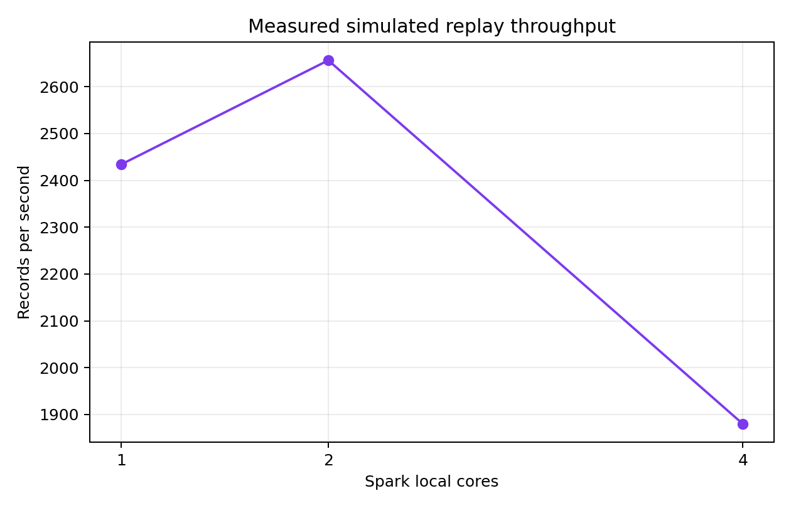
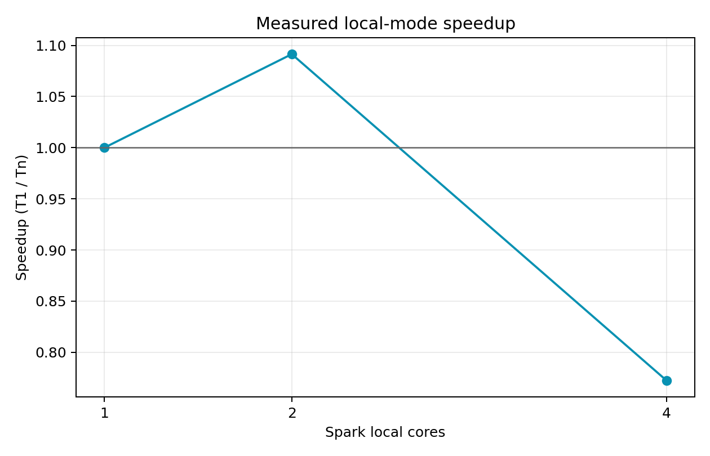

# Real-Time Social Media Sentiment Analytics on Tweet Streams

**Big Data Analytics (CSE557) | Ramaiah Institute of Technology | Submission deadline: 19 November 2026**  
**Team:** Anish Krishna (1MS24CS029), Anushka Sharad (1MS24CS035)  
**Faculty guide:** Not supplied

## Executive summary
The project processed 1,600,000 source records, retained 1,594,559 after cleaning and deduplication (99.6599%), and used a seeded 80/20 split. The 20% holdout was evaluated with Logistic Regression, Naive Bayes, and VADER. Historical JSON files were replayed through Structured Streaming as a **simulated stream**; no live Twitter/X feed was used.
On the shared holdout, Logistic Regression had the highest measured weighted F1 (0.7641).

## Scenario and questions

Social-media teams need to summarize sentiment in large volumes of short, noisy posts. This study asks how predicted positive and negative counts vary by event-time day, which cleaned words are frequent by predicted class, and how Logistic Regression, Naive Bayes, and VADER compare on one holdout set. The historical Sentiment140 file replay represents simulated streaming, not live ingestion.

## Research reference and relation to this project

Ismail, A., Sazali, F. H., Agos Jawaddi, S. N., & Mutalib, S. (2025). *Stream ETL framework for twitter-based sentiment analysis: Leveraging big data technologies*. Expert Systems with Applications, 261, 125523. DOI: [10.1016/j.eswa.2024.125523](https://doi.org/10.1016/j.eswa.2024.125523). The publisher abstract describes a framework combining Kafka, Spark, Cassandra, HBase, Hive, and HDFS for stream ETL, sentiment analysis, bias detection/correction, and geospatial visualization. It reports use cases and technology comparisons but the detailed datasets and numeric tables were not available in the abstract reviewed for this submission. The DOI contains 2024; the journal issue is dated 2025.

This implementation narrows the system to local Spark Structured Streaming and MLlib, evaluates three methods on the same fixed holdout, and measures local-core replay performance. It does not reproduce the paper’s multi-component deployment, bias correction, or mapping work. The comparison is architectural and methodological; absolute performance numbers are not comparable.

## Dataset and preparation

Sentiment140 is a headerless, latin-1 CSV with fields target, id, date, flag, user, and text. Targets 0 and 4 were mapped to negative 0 and positive 1. Rows without target, ID, text, valid event time, or non-empty cleaned text were excluded. Duplicate tweet IDs were removed before splitting. PDT/PST wall-clock times were normalized to UTC using offsets of -07:00 and -08:00. The username and ID fields were not persisted; VADER text removes handles and URLs, while model text also removes common escaped HTML entities before lowercasing and stripping to alphabetic tokens.

| Audit item | Measured value |
|---|---:|
| Source CSV size | 238,803,811 bytes |
| Raw rows | 1,600,000 |
| Retained after cleaning and deduplication | 1,594,559 |
| Removed or invalid rows | 5,441 |
| Completeness ratio | 99.6599% |
| Training rows | 1,275,793 |
| Holdout rows | 318,766 |
| Seed | 42 |
| JSON replay files | 64 |

The split used a seeded random value threshold rather than source-file order, avoiding the original label ordering bias. The recorded split counts are the actual counts from this run.

## Models and evaluation

All methods scored the same holdout rows. Logistic Regression and multinomial Naive Bayes used word tokenization, English stop-word removal, 262,144-feature HashingTF, and IDF fitted on training data only. Logistic Regression used 20 iterations and regularization 0.01; Naive Bayes used multinomial mode and smoothing 1.0. VADER compound scores at or above 0.05 were positive; neutral and negative scores were mapped to negative.

| Method | Holdout rows | Accuracy | Weighted F1 | Fit time (s) |
|---|---:|---:|---:|---:|
| Logistic Regression | 318,766 | 0.7641 | 0.7641 | 88.08 |
| Naive Bayes | 318,766 | 0.7459 | 0.7459 | 39.79 |
| VADER | 318,766 | 0.6550 | 0.6547 | Not measured |

Metrics are computed over the persisted holdout with no resampling between methods. VADER has no model fitting step; its measured scoring time was 40.89 seconds.

## Simulated streaming and performance

The trained Logistic Regression pipeline scored 64 historical JSON files through Spark Structured Streaming with `availableNow` and four files per trigger. This is a finite **simulated file replay**, not a live or paced feed. Stream time excludes model training and starts after the streaming query is started. Throughput is scored records divided by measured replay wait time. Batch durations are Spark trigger-execution times.

The host has a 13th Gen Intel Core i7-1355U (12 logical processors) and 15.69 GiB physical RAM. Docker Desktop reported about 7.60 GiB available to its Linux runtime. Spark 3.5.8 ran in the official Apache image with Java 17.0.17 and Python 3.10.12.

| Spark mode | Records scored | Replay time (s) | Throughput (records/s) | Median trigger (ms) | P95 trigger (ms) | Speedup | Window reconciliation |
|---|---:|---:|---:|---:|---:|---:|---|
| local[1] | 318,766 | 130.98 | 2433.76 | 7557 | 10932 | 1.000 | Pass |
| local[2] | 318,766 | 120.00 | 2656.28 | 7202 | 9392 | 1.091 | Pass |
| local[4] | 318,766 | 169.59 | 1879.64 | 9627 | 16371 | 0.772 | Pass |

Local-mode core scaling measures one laptop and does not establish cluster scalability. Only completed configurations are interpreted.

## Measured findings and figures

Logistic Regression had the highest measured weighted F1 (0.7641) on this holdout. This result describes Sentiment140's noisy emoticon-derived labels and the listed preprocessing; it does not establish performance on current social-media language.
The most frequent content tokens in predicted negative Logistic Regression predictions were work (9,985), go (9,557), get (9,088), like (8,095), day (7,937).
The most frequent content tokens in predicted positive Logistic Regression predictions were good (13,554), love (10,428), day (10,048), lol (7,684), like (7,566).
The daily trend contains 41 one-day UTC windows. Peak predicted-negative count: 9,289 on 2009-06-07 00:00:00; peak predicted-positive count: 12,938 on 2009-06-07 00:00:00.
The fastest measured replay used local[2] at 2656.28 records/second.

## Limitations and incomplete work

- Sentiment140 is historical (2009) and uses distant-supervision labels derived from emoticons; labels are noisy and language may not represent current users.
- The replay uses historical files and local Spark mode. It does not measure live-feed arrival latency or distributed cluster scaling.
- The selected paper is summarized from its publisher abstract. Dataset names/sizes and numerical benchmark tables from the full article are not asserted here.
- Any performance core setting not listed as measured above was not completed and must not be inferred from another run.

## Reproduction and evidence

See `README.md` for environment setup and commands. Machine-readable run evidence is in `outputs/metrics/` and `outputs/streaming/local_N/stream_metrics.json`. The raw CSV is excluded from version control. Usernames, IDs, and raw prediction text are excluded from persisted predictions; the report shows only model metrics, aggregate counts, and token frequencies.

## References

1. Ismail, A. et al. (2025). *Stream ETL framework for twitter-based sentiment analysis: Leveraging big data technologies*. Expert Systems with Applications, 261, 125523. https://doi.org/10.1016/j.eswa.2024.125523
2. Go, A., Bhayani, R., & Huang, L. (2009). *Twitter Sentiment Classification using Distant Supervision*. Sentiment140. http://help.sentiment140.com/for-students
3. Apache Spark 3.5.8 documentation. https://spark.apache.org/docs/3.5.8/
4. Apache Spark Structured Streaming programming guide. https://spark.apache.org/docs/3.5.8/structured-streaming-programming-guide.html
